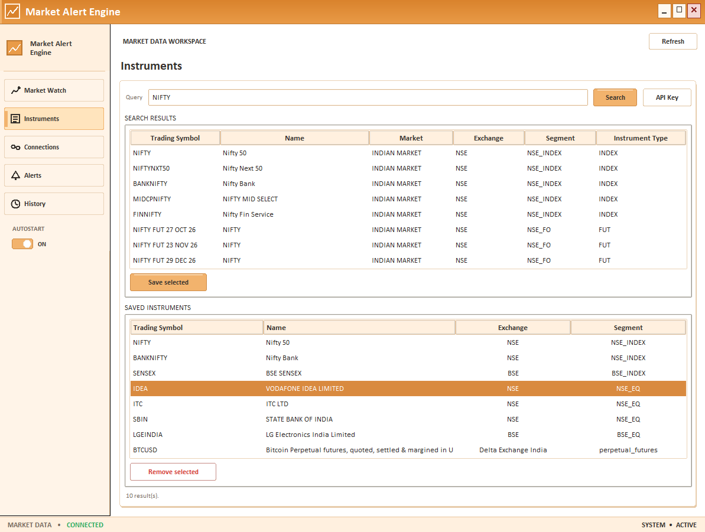
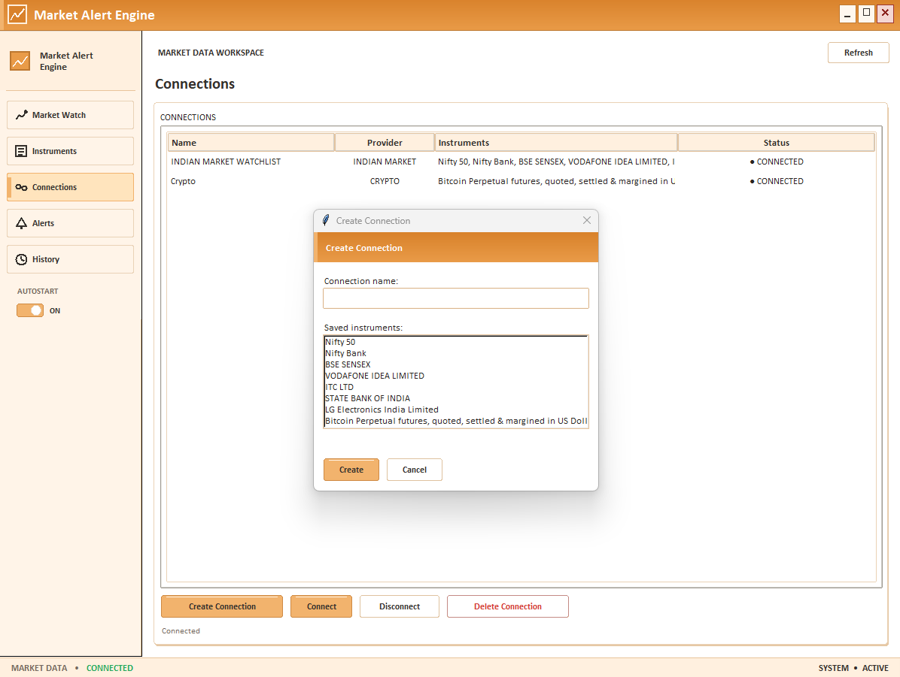
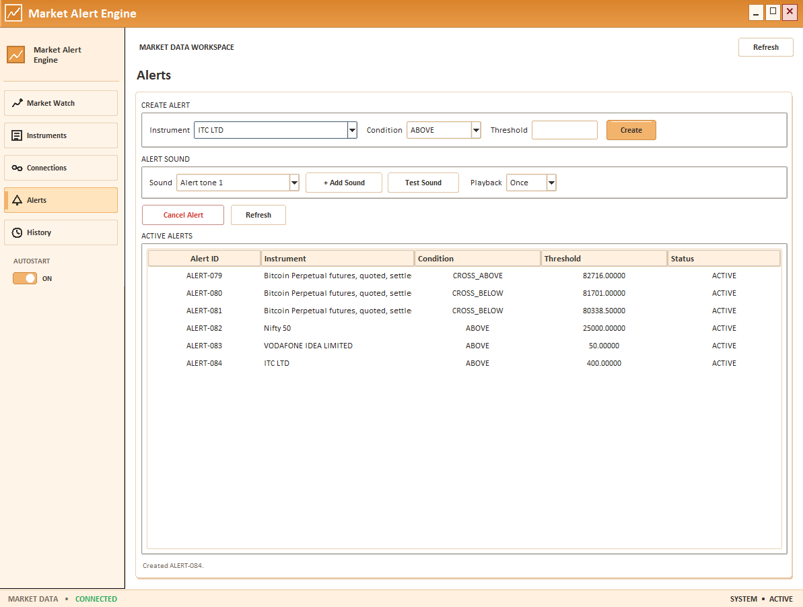
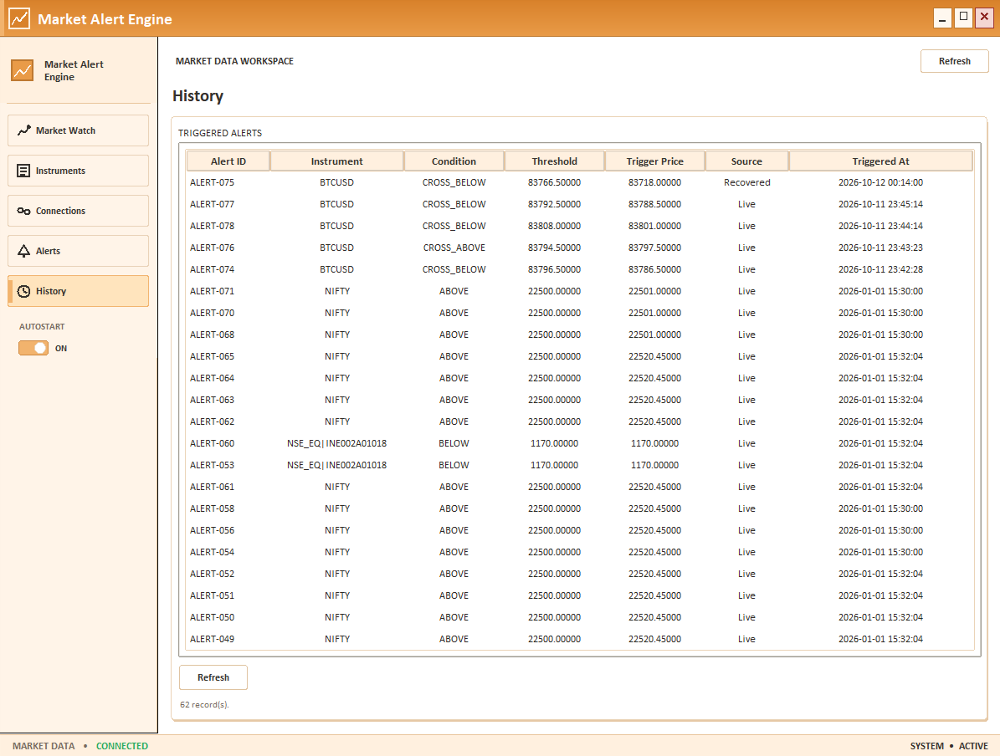

# Market Alert Engine

Market Alert Engine is a Windows desktop application for monitoring supported market-price feeds, evaluating configurable price alerts, and delivering local Windows notifications. Its GUI is built around provider-neutral price updates and locally persisted application state.

---

## 1. Project Overview

The application brings market monitoring and price alerts into a local Windows desktop workflow:

- **Market monitoring:** view live prices received from supported feeds.
- **Price alerts:** create one-shot alerts for saved instruments using threshold or crossing conditions.
- **Notifications:** deliver a Windows desktop toast and play the configured alert sound when an alert triggers.
- **Persistence:** retain saved instruments, connection metadata, active alerts, alert history, sound preferences, and market-data cursors between GUI runs.
- **Provider connectivity:** search and subscribe to instruments through the GUI-managed Upstox and Delta Exchange India adapters.

The project is designed for people who want a locally run market-monitoring and alert workflow. It is not a trading execution platform: it does not place orders or manage positions.

## 2. Technical Scope

| Area | Implementation |
|---|---|
| Language | Python |
| Desktop UI | Tkinter / ttk |
| Market data | Provider adapters + feed APIs / WebSockets |
| Architecture | Provider-neutral normalized price updates |
| Alert engine | Stateful threshold and crossing evaluation |
| Persistence | Local JSON / JSONL state |
| Credentials | Windows protected credential store |
| Notifications | Windows toast + WAV/MP3 |
| Concurrency | Worker threads + UI queue |
| Testing | API/provider integration, pytest automation, manual QA, regression validation |
| Packaging | PyInstaller |
| Platform | Windows |

## 3. Engineering Highlights

- A shared `PriceUpdate` model defines one normalized market observation, so the alert engine does not depend on provider-specific payload shapes.
- Provider adapters isolate connection setup, stream parsing, historical data access, and search behavior from the rest of the application.
- `ConnectionManager` and `GuiSession` manage multiple saved provider connections and separate connection lifecycles for each instrument set.
- The alert engine evaluates four conditions—`ABOVE`, `BELOW`, `CROSS_ABOVE`, and `CROSS_BELOW`—with stateful crossing logic based on the previous observed price.
- Active alerts, instrument metadata, connection metadata, sound preferences, history, and recovery cursors are persisted locally rather than in a cloud service.
- `WindowsCredentialStore` keeps secret values in the Windows Credential Locker instead of ordinary metadata JSON.
- Feed workers and provider operations run outside the Tkinter main thread, while the GUI consumes a thread-safe `UiQueue` to update the interface safely.
- Startup restoration and missed-alert recovery use persisted cursors and historical candle data when a provider exposes that data.
- The desktop app includes Windows notification delivery, configurable sounds, tray behavior, and opt-in autostart.
- The project maintains both automated component tests and manual provider/Windows validation, with a separate diagnostic PyInstaller build for packaged runtime investigation.

## 4. Key Engineering Challenges Solved

### Provider-specific market data normalization

Different providers expose different connection mechanisms, subscription formats, historical-data availability, and instrument identifiers. The implementation normalizes each feed payload into a shared `PriceUpdate` structure so downstream alert evaluation remains provider-neutral, instead of requiring the alert engine to understand Upstox, Delta, MT5, or simulator-specific semantics.

### Stateful crossing alerts

`CROSS_ABOVE` and `CROSS_BELOW` are not simple threshold checks. They depend on the previous price as state, and a single observation cannot establish a crossing by itself. The engine evaluates a crossing only when the prior value and current value straddle the target threshold in the correct direction, which avoids false positives from stale or first-observation data.

### Concurrent feed and GUI execution

Provider connections and market-data streams can block on network access or provider APIs. The application keeps those operations outside the Tkinter main thread and feeds the GUI through `UiQueue`, which coalesces live price updates and delivers sanitized status messages back to the UI without freezing the desktop application.

### Connection lifecycle and concurrency safety

The GUI and backend coordinate connection operations using generation tracking, in-flight request IDs, and lifecycle locks so stale connections, overlapping connect/disconnect work, and duplicated result handling do not race with alert state or UI updates. Alert cancellation and trigger completion are also serialized behind the alert-state lock.

### Production packaging diagnosis

The repository maintains a separate diagnostic PyInstaller configuration (`market_alert_engine_debug.spec` plus `diagnostic_runtime_hook.py`) to investigate packaged-runtime behavior separately from the production windowed executable. This is used to isolate issues in the bundled runtime without conflating them with the normal GUI build.

### Startup recovery

On restart, saved connection metadata and market-data cursors are restored, and the app can perform bounded missed-alert checks using historical candle data when available. This gives the application a practical recovery path after a restart without pretending that a local desktop app can reconstruct missing provider events beyond the supported historical window.

## 5. Key Design Decisions

### Provider-neutral core

Provider-specific logic remains in feed and resolver adapters, while the alert engine and the rest of the application operate on normalized price updates. This keeps the business rules independent of any one market-data provider.

### Local-first architecture

The application is designed as a local Windows desktop tool rather than a cloud-hosted monitoring service. The state is kept in local stores and provider credentials are treated as user-managed local configuration.

### Credentials outside ordinary application state

Credentials are stored through the Windows protected credential mechanism rather than ordinary JSON metadata. This keeps secrets separate from persisted connection and instrument records while remaining compatible with a local desktop workflow.

### GUI as a presentation/control layer

The GUI coordinates backend services and session state instead of reimplementing the core alert logic in each view. This preserves a clear separation between presentation, session orchestration, and the alert engine itself.

### Separate diagnostic packaging

The project maintains a console-visible diagnostic executable alongside the production windowed build so runtime-debugging can proceed without altering the main packaged distribution path.

### Explicit limitations

The README documents limits and pending validation explicitly instead of implying they are complete. That includes unimplemented trading features, bounded recovery logic, and provider-specific validation status, which keeps the project honest about what is delivered and what remains unverified.

## 6. What This Project Demonstrates

- API and WebSocket integration for live provider feeds and market-data access.
- provider abstraction and data normalization using a shared `PriceUpdate` model and adapter boundaries.
- event-driven application design across feed callbacks, queue-based GUI updates, and notification delivery.
- stateful business-rule evaluation for threshold and crossing alerts.
- concurrency and thread-safe UI communication between worker threads and Tkinter.
- persistence and recovery design for instruments, alerts, connections, history, and market-data cursors.
- credential handling through a protected Windows credential store.
- API/integration testing, automated regression checks, and manual QA, with documented live-provider and Windows-specific validation where performed.
- debugging packaged-runtime behavior with separate diagnostic builds.
- Windows desktop integration, including notifications, sound settings, tray behavior, and autostart.
- executable packaging and release validation workflows.
- requirements traceability and iterative SDLC practices.

## 7. The Problem

The difficulty is not simply displaying prices in a desktop UI. It is coordinating multiple providers, each with different connection mechanisms, subscription patterns, historical-data availability, authentication requirements, and instrument identifiers, while keeping one consistent local alerting workflow for the user.

A local application must also preserve state across runs, handle provider-specific failures without collapsing the whole session, and present notifications in a Windows-native way. The project addresses this by normalizing feed data into a provider-neutral `PriceUpdate` model, isolating provider adapters behind a shared interface, and keeping alert evaluation, persistence, and notification behavior consistent across the application.

It is not intended to claim parity with external trading or alerting platforms; rather, it provides a focused local desktop implementation for configurable price conditions, market monitoring, and Windows notification delivery.

## 8. Project Goals and Requirements

The requirements represented in the implementation and QA materials include:

- Live market-price monitoring through supported providers.
- Multiple instruments and provider-neutral price updates.
- `ABOVE`, `BELOW`, `CROSS_ABOVE`, and `CROSS_BELOW` alert conditions.
- Saved instruments, saved connections, active alerts, and alert history.
- Separation of provider credentials from ordinary JSON metadata.
- Windows desktop notifications and configurable alert sounds.
- A usable Windows GUI, system tray behavior, and opt-in login autostart.
- Startup restoration of saved connections and recovery checks for missed alerts where provider history is available.

The repository's [requirements traceability matrix](./docs/REQUIREMENTS_TRACEABILITY.md) maps its documented requirements to implementation components, automated tests, and manual test records. Its requirement IDs are preserved there rather than recreated here.

## 9. Product Evolution / SDLC

The repository documents a progression from a small alert engine and simulated feed toward a locally persistent Windows application. It does not establish dated milestones for every later feature, so the outline below describes implementation areas rather than a dated chronology:

1. **Alert foundation:** define alert models, lifecycle management, and condition evaluation.
2. **Repeatable market input:** add a seeded simulator to exercise the engine without a live provider.
3. **Trigger delivery and history:** add a FIFO notification queue, Windows delivery channels, and trigger records.
4. **Feed abstraction and live adapters:** normalize market data and add MT5 and Upstox paths.
5. **Instrument discovery and connection lifecycle:** search provider catalogs, save instruments, and manage multi-instrument connections.
6. **Desktop application:** compose the existing backend services behind a Tkinter/ttk GUI with Market Watch, Instruments, Connections, Alerts, and History views.
7. **Additional provider and recovery behavior:** add Delta public ticker data, local state stores, startup restoration, market-data cursors, and historical missed-alert checks.
8. **Windows workflow and packaging:** add custom sound selection, tray/autostart integration, and production and diagnostic PyInstaller specs.
9. **Validation and hardening:** use automated component/integration tests and manual QA records to investigate and retest observed issues.

The repository records a concrete example of iterative hardening: the first manual notification check found that a successful toast command did not produce a visible toast and that asynchronous sounds could overlap. The testing log records the subsequent implementation changes and passing manual retest. See [TESTING_LOG.md](./docs/TESTING_LOG.md), [TEST_PLAN.md](./docs/TEST_PLAN.md), and [REQUIREMENTS_TRACEABILITY.md](./docs/REQUIREMENTS_TRACEABILITY.md).

## 10. Final Architecture

The main GUI flow is:

```text
Indian Market feed ──┐
                     │
Crypto feed ─────────┼──> provider adapters ──> PriceUpdate ──> ConnectionManager
                     │                                      (feed threads)
Forex feed ──────────┘
                                                                  │
                                                                  v
                                                             GuiSession
                                                ┌─────────────────┴─────────────────┐
                                                │                                   │
                                                v                                   v
                                             UiQueue                           AlertEngine
                                                │                          ┌────────┼────────┐
                                                v                          v        v        v
                                         Tk main thread                AlertManager History NotificationQueue
                                          / GUI views                       │        │        │
                                                │                      ActiveAlert   JSONL  NotificationHandler
                                                v                         Store             (toast + sound)
                                          Market Watch

              Connection/instrument/sound metadata and market-data cursors
                                   are stored locally.
```

The simulator is used by the CLI and tests. MT5 is implemented as a feed adapter and CLI path; it is not among the GUI session's configured connection providers.

## Product Screenshots

### Market Watch

The real-time monitoring view shows connected instruments, current prices, update timestamps, and connection status.


### Instruments

Search provider catalogs and manage the locally saved instruments used by the application.



### Connections

Manage named provider connections and the instruments subscribed through each connection.



### Alerts

Configure threshold and crossing alert conditions for monitored instruments.



### Alert History

Review triggered alerts retained in the local history.



## 11. Core Components

| Component | Responsibility |
|---|---|
| `PriceUpdate` / `PriceFeed` | Standard price observation and provider-neutral feed interface. |
| `ConnectionManager` | Persists non-secret connection data, creates provider adapters, connects subscriptions, forwards updates, tracks status, and disconnects/deletes connections. |
| `CredentialStore` | Abstract credential API; the Windows implementation uses the Windows keyring backend. |
| `InstrumentStore` | Saves and lists provider-neutral instrument metadata. |
| Instrument resolvers and search aggregator | Search configured provider catalogs and merge results while reporting provider failures independently. |
| `AlertCondition`, `Alert`, `AlertStatus` | Define validated alert values, supported conditions, and lifecycle states. |
| `AlertEngine` | Evaluates normalized price updates, tracks prior prices by instrument, and completes triggers. |
| `AlertManager` | Creates, lists, cancels, and marks alerts triggered; the GUI configures it with persistent active-alert storage. |
| `ActiveAlertStore` | Loads and atomically replaces the GUI's active-alert snapshot. |
| `AlertHistory` | Records unique trigger events with trigger price and UTC timestamp; the GUI supplies a persistent JSONL path. |
| `NotificationQueue` / `NotificationHandler` | Queue triggered alerts in FIFO order and attempt sound and desktop notification delivery. |
| `NotificationSoundSettings` | Manages the selected sound, imported sound metadata, and once/twice playback preference. |
| `GuiSession` | Composes backend services for the GUI and provides the boundary between worker operations and UI messages. |
| GUI views | Present Market Watch, Instruments, Connections, Alerts, and History. |
| `UiQueue` | Transfers worker/feed events to the Tk thread and coalesces pending prices by instrument. |
| Windows tray/startup modules | Implement tray icon behavior and current-user Windows Run registry autostart. |
| Historical candle adapters and `MissedAlertRecovery` | Retrieve provider candles and conservatively check for triggers missed during a bounded recovery period. |

## 12. Provider Architecture

Provider-specific adapters implement shared internal interfaces so the alert engine can evaluate normalized updates rather than provider-specific payloads.

### Upstox

- Uses the Upstox Market Data Feed V3 authorization flow and WebSocket connection.
- Requires an access token for instrument search and live market data.
- Authorization uses Windows WinHTTP/Schannel; the WebSocket client is `websockets`.
- Subscribes to one or more instrument keys in LTPC mode and decodes binary protobuf feed messages into last-traded-price `PriceUpdate` objects.
- Instrument discovery uses the Upstox instrument search API. Results can be saved locally and used for connections and alerts.
- An Upstox one-minute historical candle adapter is present for missed-alert recovery.
- The repository's manual test log records a live V3 update for `NSE_INDEX|Nifty 50`; live service access requires a valid user token and network connectivity.

### Delta Exchange India

- Searches the public products catalog and filters matching live/active products.
- Uses a public ticker WebSocket feed and normalizes ticker updates to `PriceUpdate`.
- Supports multi-instrument subscriptions and provider-scoped `delta:` instrument keys.
- Public ticker data does not require credentials. Optional API key/secret values can be stored, but they are not required by the implemented public feed.
- A public one-minute historical candle adapter is present for missed-alert recovery.
- With no saved connection at startup, the GUI attempts to find a BTC product and start a public Delta connection.

### MetaTrader 5

`MT5PriceFeed` is an adapter for an installed MetaTrader 5 Python package and running terminal. The CLI exposes a live-feed option for `XAUUSDm`; updates use the bid/ask midpoint and a UTC timestamp. The adapter initializes and shuts down the terminal around its stream. The GUI session does not configure MT5 as a managed connection provider.

### Simulator

`SimulatedPriceFeed` is a seeded random-walk source with a fixed set of configured instruments spanning Forex, commodities, crypto, US equities, indices, and Indian instruments. It provides repeatable input for the CLI and automated tests without a live data connection. It is not a live market-data provider.

### Forex

Forex is a supported API-key/credential category in the application's API Key functionality. Users can enter and store Forex API credentials in the Windows protected credential store, and the instrument model recognizes `forex:` keys. Forex provider/API credential infrastructure is present, but live Forex market-data integration has not yet been fully implemented and validated end-to-end. The repository does not establish a specific Forex provider or API.

No provider adapter implements order placement or trade execution.

## 13. Alert Engine

The four supported conditions are:

| Condition | Trigger rule |
|---|---|
| `ABOVE` | Current price is greater than or equal to the target. |
| `BELOW` | Current price is less than or equal to the target. |
| `CROSS_ABOVE` | Previous price is less than or equal to the target and current price is greater than the target. |
| `CROSS_BELOW` | Previous price is greater than or equal to the target and current price is less than the target. |

Crossing rules require a previous observation for the same instrument. The first update establishes the previous price; it cannot by itself prove a crossing. In the GUI, creating an alert evaluates it against the latest known price, so an `ABOVE` or `BELOW` alert may trigger immediately if its condition is already true. A new crossing alert has no prior price for that new-alert check.

An alert transitions from active to triggered or cancelled and is not intended to trigger repeatedly. The engine tracks previous prices independently by instrument key, and only evaluates alerts whose symbol matches the update's instrument key. The GUI serializes relevant alert state operations to protect cancellation/trigger behavior. History deduplicates records by alert ID, and the engine only queues a notification when it records a new trigger.

For startup recovery, the application can use historical candles to check active alerts against a bounded gap. Because OHLC data does not reveal every tick path, recovery applies conservative candle rules and reports an approximate trigger time.

## 14. Persistence Architecture

The GUI stores application data under `%LOCALAPPDATA%\MarketAlertEngine` when `LOCALAPPDATA` is available. The code falls back to a per-user `AppData\Local\MarketAlertEngine` location. These files contain local application state, not live market tick histories.

| Store | Contents | Lifecycle |
|---|---|---|
| `connections.json` | Connection IDs, names, providers, and subscribed instrument keys; no credential values. | Loaded at startup; updated when connections are created or deleted. |
| `instruments.json` | Saved instrument keys and descriptive fields. | Loaded at startup; updated on save/removal. |
| `active_alerts.json` | Next alert ID and active alert fields. | Loaded at startup; updated on create, cancel, and trigger. Triggered/cancelled alerts are not kept in the active snapshot. |
| `alert_history.jsonl` | Alert ID, instrument, condition, target, actual trigger price, UTC time, and recovered flag. | Appended when an alert triggers and loaded at startup. |
| `market_data_cursors.json` | Latest recorded timestamp per provider and instrument. | Updated as feed data arrives, flushed periodically and on GUI session shutdown; used to bound recovery. |
| `notification_sounds.json` | Imported sound IDs/names, selected sound, and playback preference. | Updated when sound selection/import or playback preference changes. |
| `sounds/` | Copies of imported WAV/MP3 sound files. | Written during sound import. |
| Windows Credential Locker | Provider credentials keyed by provider namespace and account/connection identifier. | Read when needed for provider operations; retained or deleted according to connection/account actions. |

On normal GUI exit, active feeds are disconnected, market-data cursors are flushed, and saved connection credentials are preserved. At the next launch, saved connections are reconnected asynchronously. If no saved connections exist, the app attempts its initial public Delta BTC connection. This is startup restoration, not a claim of automatic retry after every runtime network interruption.

Disconnecting an individual connection stops its feed but preserves its metadata and credential. Deleting a connection removes its metadata and per-connection credential; separately saved account-level credentials are distinct. The GUI's account-level disconnect actions remove provider credentials and stop that provider's saved feeds while retaining connection metadata. Triggering or cancelling an alert updates the active-alert snapshot; a trigger is also appended to history. The GUI notification queue itself is in memory, not a persistent delivery queue.

The CLI constructs alert manager and history instances without persistent file paths. The persistence description above refers to the GUI application.

## 15. Credential and Security Model

The GUI's `WindowsCredentialStore` uses the `keyring` Windows Vault backend. Credentials are stored under a provider-specific service namespace, with account or connection IDs as credential identifiers. The code does not establish encryption algorithms or other Credential Locker implementation details, so no additional cryptographic guarantee is claimed here.

The API Key functionality exposes three credential categories: **Indian Market**, **Crypto**, and **Forex**. Forex credentials can be entered and stored, but this does not imply a validated live Forex market-data integration.

- Connection and saved-instrument JSON files contain metadata and are designed without credential fields.
- Upstox access tokens are stored at an account level for reuse/search and under connection identifiers for feed lifecycle operations.
- Delta API key/secret data can be stored under account and connection identifiers, but the public market-data feed does not need it.
- Forex key and secret values use separate provider-scoped identifiers, despite the absence of a configured Forex feed.
- Individual connection disconnect preserves its credential. Connection deletion removes its per-connection credential. Provider account disconnect removes the stored provider-level and connection-level credentials through the GUI session.
- Credential entry fields are masked in the GUI; the CLI uses a hidden prompt for access-token entry. Provider error handling includes sanitization/redaction before status display.
- Real credentials should be entered locally and must not be placed in source files, tests, logs, documentation, or committed project files. The repository's ignore rules exclude common local credential and secret file patterns.

These statements describe visible implementation behavior, not a comprehensive security audit.

## 16. Notification System

When the GUI alert engine completes a trigger, it enqueues a notification containing the alert and triggering price. The session processes notifications in FIFO order through `NotificationHandler`, which attempts the configured sound and Windows desktop toast independently.

The Alerts view exposes:

- **Windows Default:** plays the `SystemExclamation` sound alias.
- **Alert tone 1:** bundled as `assets/sounds/custom_alert.mp3`.
- **Imported sounds:** WAV or MP3 files copied into the local app-data sound directory. WAV files are checked for valid WAV structure at import.
- **Playback:** once or twice.
- **Test Sound:** plays the currently selected sound without requiring an alert trigger.

WAV playback uses Windows `winsound`; MP3 playback uses the Windows MCI interface. Playback is synchronous so successive alert sounds do not overlap through concurrent playback. Sound metadata and selection preferences persist locally; imported audio is stored separately as files. The desktop toast uses Windows PowerShell/WinRT notification APIs. Actual audio and toast presentation require a Windows environment; automated notification tests mock channel delivery.

## 17. Reliability and Recovery

The GUI separates blocking work and UI updates:

- Provider feed consumption and search/connection/alert operations use worker threads.
- Feed and worker results are delivered through `UiQueue`; Tk widgets are updated by the Tk main loop.
- Pending price updates are coalesced by instrument, keeping the newest queued value per instrument while retaining action messages separately.
- Connection lifecycle state, request IDs, and connection generations guard overlapping operations and stale connect results. The session also coordinates alert cancellation and triggering under a shared alert-state lock.
- Queue draining is scheduled on the Tk thread and guarded against window teardown and per-message failures.
- GUI shutdown stops queue polling, closes the tray icon, marks the session closed, and disconnects feeds without waiting indefinitely on the UI thread; cursor flushing runs as part of backend close.
- Provider errors are reflected in per-connection state rather than being treated as successful connection status.
- Startup reloads active alerts and history, reconnects saved connections, and initiates missed-alert recovery when a saved provider connection is available.
- Recovery uses persisted market-data cursors and a maximum 24-hour recovery window. Delta and Upstox one-minute candle adapters are present. The recovery engine accepts only conditions that candle OHLC data can establish under its rules; its trigger time is approximate.

Startup reconnection does not imply automatic retry of a failed connection while the application remains open. Recovery depends on provider candle availability, saved connection/instrument identity, and credentials where the provider requires them.

## 18. Windows Desktop Integration

The GUI uses Tkinter and ttk with a custom borderless application shell. On Windows, a native Shell tray icon provides Open and Exit actions. Minimizing or closing the window hides it to the tray when the tray integration is active; Exit shuts down the app and provider feeds.

Autostart is opt-in and writes/removes a value for the current user under the Windows Run registry key. It is exposed through the GUI switch and these source commands:

```powershell
python -m gui --enable-autostart
python -m gui --disable-autostart
```

The hidden startup option is `--start-hidden`. In source execution, the startup entry uses the GUI module entry script and prefers `pythonw.exe` if available. In a frozen executable, it uses the executable path with `--start-hidden`.

One packaging consideration reflected in the implementation is that the startup command must target the executable in frozen mode rather than rely on a module file path that may refer to a temporary PyInstaller extraction directory. The code handles frozen and source execution separately.

The production build is configured as a windowed PyInstaller executable. See [Packaging and Release](#21-packaging-and-release).

## 19. GUI Design

The desktop navigation exposes:

1. **Market Watch** — live prices, exchange, update time, and feed status.
2. **Instruments** — provider catalog search, saved instrument management, and credential settings.
3. **Connections** — create/connect/disconnect/delete controls and per-connection status.
4. **Alerts** — alert creation/cancellation and sound selection/testing.
5. **History** — triggered and recovered alert records.

An **Autostart** control is also present in the navigation area. The interface uses a warm, orange-and-neutral visual theme, custom application chrome, status indicators, and tables for data-oriented views.

The GUI is the presentation layer over shared session/backend services: Market Watch consumes normalized updates, Instruments manages provider-neutral saved metadata, Connections manages provider lifecycles, Alerts delegates to the backend alert engine, and History reads trigger records.

## 20. Testing and Validation

Automated tests are organized under `tests/` and cover alert evaluation and lifecycle, history, connection management, credential storage, instrument storage/search, GUI session and views, simulator and MT5 adapter behavior, Upstox feed/resolver behavior, notification queue, sound settings, and Windows startup behavior.

The repository contains 24 `test_*.py` files. A source-pattern count finds 201 test-function declarations; this is not a pytest-collected test count, because parametrization and collection rules can change the final number.

### Testing Approach

- **API / integration testing:** Automated tests exercise provider boundaries using mocked HTTP/authorization responses, mocked WebSocket/feed messages, and fake MT5 API behavior. Coverage includes Upstox authorization and feed normalization, instrument-search response handling, and integration paths that carry normalized updates into connection and alert processing. These mocked checks are not live API tests. The documented live provider check is the Upstox V3 feed scenario TR-008; live MT5 terminal validation remains pending.
- **Automated testing:** pytest component and integration tests use deterministic prices and timestamps, fake credentials, mocked provider boundaries, and fake notification handlers where appropriate. They verify application behavior without depending on live market data or real Windows notification channels.
- **Regression validation:** the test plan calls for rerunning the pytest suite after relevant changes. The manual QA log also records an initial toast/audio defect, its fixes, and a successful manual retest in TR-004; this is documented regression evidence, not a claim that the full suite currently passes.
- **Manual testing / QA:** [TESTING_LOG.md](./docs/TESTING_LOG.md) records scenarios TR-001 through TR-008, including simulated and end-to-end alert flows, notification and history behavior, CLI workflows, actual Windows toast/sound checks, and the Upstox V3 live feed. These records do not imply that every provider was validated live.
- **Packaged application / Windows validation:** the project owner reports that the production executable was manually validated. The QA log does not identify the exact executable file or record the steps run against that packaged binary. A separate diagnostic executable supports packaged-runtime investigation; its existence is not evidence that every packaged scenario was tested. The traceability matrix marks Windows Credential Locker verification as pending.

No claim that the complete automated suite currently passes is made here. The [test plan](./docs/TEST_PLAN.md), [manual test log](./docs/TESTING_LOG.md), and [requirements traceability matrix](./docs/REQUIREMENTS_TRACEABILITY.md) contain additional scope and evidence.

## 21. Packaging and Release

The repository uses PyInstaller spec files:

- `market_alert_engine.spec` is the production configuration. It starts at `gui/__main__.py`, bundles `assets/sounds/custom_alert.mp3`, declares `websockets` as a hidden import, and configures a windowed executable (`console=False`). It builds directly through PyInstaller's `EXE` target without a separate `COLLECT` directory step.
- `market_alert_engine_debug.spec` builds a console-visible diagnostic executable and includes `diagnostic_runtime_hook.py`. It is distinct from the production configuration.

The production executable present in `dist/` is `MarketAlertEngine.exe`. A diagnostic executable is present in `dist-debug/` as `MarketAlertEngine-Diagnostic.exe`. The final production executable was reported as built and manually validated; no version number, hash, signature, or reproducible-build claim is provided.

The executable targets Windows desktop use. Providers requiring authentication still require the user's own valid credentials configured locally; the executable does not bundle user credentials.

## 22. Known Limitations

- Forex API credential configuration and protected storage are present, but live Forex market-data integration has not yet been fully implemented and validated end-to-end.
- No order placement, trade execution, position management, or portfolio accounting is implemented.
- The application is a local desktop process; a cloud/server-side monitoring service is not part of the current architecture.
- Because monitoring runs locally, the app cannot monitor markets while the user's computer or application is not running. Startup recovery can inspect available historical candles after a restart, but it does not provide continuous monitoring while the device is off.
- Startup reconnects saved connections; the code does not establish automatic retry for every feed failure while the app remains running.
- MT5 is available through its adapter/CLI path, not the GUI-managed connection list.
- Missed-alert recovery is bounded and candle-based. It supports the configured Upstox and Delta historical adapters, depends on historical data access, and reports approximate trigger times.
- Notification audio and Windows toast display require Windows facilities; automated tests mock these channels.
- Upstox live use requires a valid access token and network/provider availability. Delta public feed/catalog operations also require network access.
- The notification queue is in memory; durable replay of notifications after process failure is not implemented.
- The simulator's deterministic output depends on its seed and call order.

## 23. Project Structure

```text
Market-Alert-Engine/
├── assets/
│   └── sounds/                 # Bundled notification sound
├── data/                       # Feeds, providers, stores, search, recovery data
├── docs/                       # Requirements traceability and QA records
├── engine/                     # Alert evaluation, management, recovery
├── gui/                        # Tkinter app, views, session, tray/startup
├── history/                    # Trigger-history model and storage
├── models/                     # Alert and instrument models
├── notifications/              # Queue, Windows delivery, sound settings
├── tests/                      # Automated component/integration tests
├── dist/                       # Production executable
├── dist-debug/                 # Diagnostic executable
├── main.py                     # Separate CLI entry point
├── market_alert_engine.spec    # Production PyInstaller spec
├── market_alert_engine_debug.spec
├── requirements.txt
└── mt5_tick_probe.py           # One-shot MT5 tick probe
```

PyInstaller analysis/build intermediates are generated in `build/` and `build-debug/`. Cache and virtual-environment directories are omitted.

## 24. Installation and Usage

### Option A: Run the packaged application

Use the production `dist/MarketAlertEngine.exe` on Windows. Provider features that require authentication need the user's own valid credentials entered through the application. No developer toolchain is required to launch the packaged executable.

### Option B: Run from source

Use a Python environment on Windows. Install the dependencies from the project root:

```powershell
python -m pip install -r requirements.txt
```

Run the desktop application:

```powershell
python -m gui
```

The interactive CLI is a separate entry point:

```powershell
python main.py
```

The CLI provides simulation, alert operations, Upstox connection/instrument management, and an MT5 live-feed option. The production packaged executable starts the GUI, not the CLI.

### Dependencies

The repository's `requirements.txt` lists:

- `keyring` for the Windows protected credential-store integration.
- `websockets` for provider WebSocket clients.
- `protobuf` for Upstox feed-message decoding.
- `MetaTrader5` for the optional MT5 adapter/CLI path.
- `pytest` for automated tests.

The repository uses PyInstaller spec files to build executables, but PyInstaller is not listed in `requirements.txt`. It is needed separately to rebuild the packaged application. The repository does not declare a formal supported Python-version range; the test plan records Python 3.14 on Windows for its manual checks.

### Typical GUI workflow

1. Open **Instruments** and search the configured Upstox or Delta catalog. Upstox search requires a stored access token; Delta catalog search uses its public endpoint.
2. Save the instruments to monitor.
3. Open **Connections**, create a connection from one or more saved instruments, and provide Upstox credentials when prompted. Delta public data does not require API credentials.
4. Connect and verify the connection status and incoming rows in **Market Watch**.
5. In **Alerts**, select a saved instrument, condition, and threshold. Choose/test an alert sound if desired.
6. Review fired alerts in **History**. The GUI persists alert history locally.

To enable or disable current-user login startup from source:

```powershell
python -m gui --enable-autostart
python -m gui --disable-autostart
```

Autostart can also be changed using the GUI control. Use the tray's **Exit** action to close the application and disconnect feeds rather than leaving it hidden.

For automated checks, the repository test plan documents the pytest workflow:

```powershell
python -m pytest
```

## 25. AI-Assisted Development Workflow

The project used an iterative, human-directed engineering workflow. Requirements and product decisions were human-driven; AI assistance supported implementation and debugging but did not replace running the application, reviewing behavior, or making engineering decisions.

```text
Human defines requirements
          ↓
Implementation with AI assistance
          ↓
Human runs the application and tests
          ↓
Observed behavior / defect
          ↓
Investigation and scoped change
          ↓
Automated regression tests
          ↓
Manual provider / Windows validation
          ↓
Documentation and packaging
```

The repository supports this account through its traceability matrix, test plan, automated tests, and manual QA log. The logged notification issue and retest demonstrate that observed behavior informed a controlled implementation change rather than an unverified patch. Live-provider and Windows-specific checks remain distinct from mocked automated tests.

## 26. Final Outcome

Market Alert Engine evolved from an alert-engine concept into a Windows desktop market-alert application with provider-neutral price updates, Upstox and Delta live-data paths, instrument discovery, multi-instrument connections, configurable alerts, locally persisted state, protected local credential handling, Windows notifications, configurable sounds, tray/autostart integration, and bounded startup recovery.

The project demonstrates an engineering workflow from requirements and architecture through implementation, testing, debugging, hardening, packaging, and validation—while keeping market monitoring separate from trading execution.
